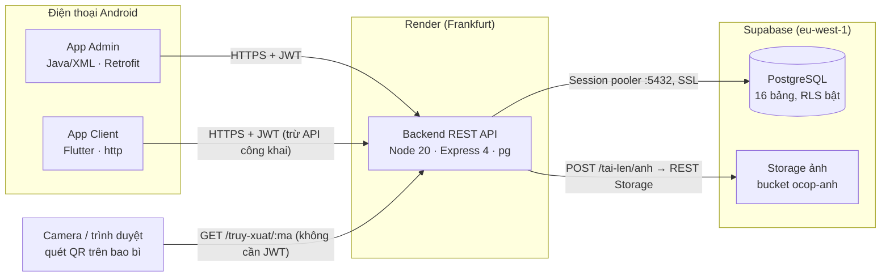
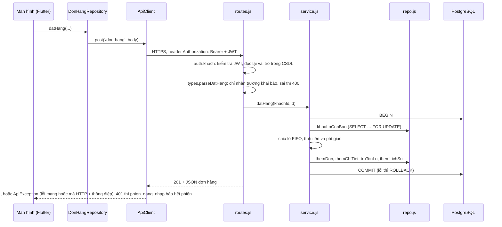

# Kiến trúc mã nguồn

Nguồn và cách phân biệt yêu cầu: xem [README](../README.md).

**Đề xuất.** Đề không quy định kiến trúc mã nguồn; đây là lựa chọn của nhóm và cần cả nhóm thống nhất. Backend và hai app đã theo kiến trúc này, và quy tắc phụ thuộc được **kiểm tra bằng máy** (backend trong `npm test`, app Admin bằng ArchUnit, app Client bằng `flutter test`).

Cài đặt và chạy: [Setup](Setup.md). Quy trình làm việc nhóm: [Contributing](Contributing.md).

## Tổng quan hệ thống

Phần này là **Bắt buộc** theo phần B của đề: công nghệ, nơi chạy và việc hai app dùng chung một backend và một CSDL.



| Thành phần | Công nghệ | Chạy ở đâu | Thư mục |
| --- | --- | --- | --- |
| App Admin cho quản trị và nhân viên | Android Studio, Java, XML, minSdk 24, Retrofit 2 + Gson | Điện thoại hoặc máy ảo Android | `admin-android/` |
| App Client cho khách và nhà cung cấp | Flutter 3.35+, Dart 3, gói `http`, `shared_preferences` | Điện thoại hoặc máy ảo Android | `client-flutter/` |
| Backend REST API | Node.js 20, Express 4, `pg` (SQL thuần), `jsonwebtoken`, `bcryptjs` | Render Web Service gói Free: https://ocop-backend.onrender.com | `backend/` |
| CSDL | PostgreSQL trên Supabase gói Free | Supabase project `Gugugaga-Android` | `backend/db/` |

Nguyên tắc chung:

- **Hai app không bao giờ kết nối thẳng vào Supabase** và không chứa khóa Supabase nào. Mọi dữ liệu đi qua backend.
- **Backend là nơi duy nhất quyết định** quyền, giá, trạng thái và tính hợp lệ. App chỉ hiển thị, và ẩn nút cho đẹp; backend vẫn chặn bằng 401/403/409.
- **Mọi bảng bật RLS mà không có policy**, nên REST API tự động của Supabase không đọc hay ghi được gì. Backend kết nối bằng chủ sở hữu bảng nên không bị chặn.
- **Bí mật** (`DATABASE_URL`, `JWT_SECRET`) chỉ nằm trong biến môi trường của Render, hoặc trong `backend/.env` trên máy cá nhân (không commit).
- **Mỗi lô có mã truy xuất** 20 ký tự hex, sinh từ 80 bit ngẫu nhiên. QR in đường dẫn `https://ocop-backend.onrender.com/truy-xuat/<mã>`. App Client tách mã từ đường dẫn rồi gọi API công khai.

### Đường đi của một yêu cầu

Ví dụ: khách bấm "Đặt hàng" trên app Client (`screens/dat_hang_screen.dart`).



### Bản đồ miền nghiệp vụ

| Miền (`backend/src/domains/`) | Đường dẫn API | Bảng chính | Trạng thái |
| --- | --- | --- | --- |
| `he-thong` | `/health` | — | Xong |
| `tai-khoan` | `/auth` | `nguoi_dung` | Xong: đăng ký, đăng nhập, `GET /auth/toi` |
| `danh-muc` | `/vung-nguyen-lieu` | `vung_nguyen_lieu` | Xong |
| `nha-cung-cap` | `/nha-cung-cap`, `/quan-tri/nha-cung-cap`, `/cua-toi/nha-cung-cap` | `nha_cung_cap`, `chung_nhan` | Xong: nhập hồ sơ, duyệt, nhà cung cấp tự gửi hồ sơ |
| `san-pham` | `/san-pham`, `/quan-tri/san-pham`, `/cua-toi/san-pham` | `san_pham` | Xong: danh sách, lọc, duyệt, chốt hạng sao, nhà cung cấp tự gửi sản phẩm |
| `truy-xuat` | `/lo-san-xuat`, `/truy-xuat/:ma` | `lo_san_xuat`, `buoc_truy_xuat` | Xong: lô, bước, QR công khai |
| `don-hang` | `/gio-hang`, `/don-hang`, `/quan-tri/don-hang` | `gio_hang`, `don_hang`, `chi_tiet_don`, `lich_su_trang_thai_don` | Xong: giỏ, đặt đơn FIFO, chuyển trạng thái |
| `danh-gia` | `/danh-gia` | `danh_gia`, `anh_danh_gia` | Xong: đánh giá đơn đã nhận kèm ảnh |
| `phan-anh` | `/bao-cao-vi-pham`, `/quan-tri/bao-cao-vi-pham` | `bao_cao_vi_pham` | Xong: khách gửi, nhân sự xử lý |
| `tuong-tac` | `/yeu-thich`, `/theo-doi` | `yeu_thich`, `theo_doi_nha_cung_cap` | Xong |
| `bao-cao` | `/bao-cao/doanh-so` | đọc `don_hang`, `chi_tiet_don`, `lo_san_xuat` | Xong: theo vùng, hạng sao, top nhà cung cấp |
| `tai-len` | `/tai-len/anh` | Supabase Storage (bucket `ocop-anh`) qua `providers/storage.js` | Xong; cần khóa `SUPABASE_SERVICE_KEY` trên Render |

Chi tiết từng endpoint: [API](API.md). Bảng và quan hệ: [Data model](Data_model.md). Quy tắc nghiệp vụ đang áp dụng: [Design decisions](Design_decisions.md).

## Backend: miền nghiệp vụ phân tầng

Backend chia theo **miền nghiệp vụ** (`backend/src/domains/<miền>/`). Trong mỗi miền, code chỉ phụ thuộc theo một chiều:

```
types → config → repo → service → routes → index
```

Các mối quan tâm xuyên suốt (CSDL, JWT/vai trò, bcrypt, sinh số ngẫu nhiên, log, xử lý lỗi HTTP) chỉ đi vào qua một cửa là `providers/`. Hàm thuần dùng chung nằm trong `utils/`. `app.js` (App Wiring) tạo Providers, ghép các miền và gắn đường dẫn.

```
backend/src/
  app.js, server.js, config.js   App Wiring
  providers/   db (pg, transaction), auth (JWT, vai trò), password (bcrypt),
               random (crypto), logger, http (lỗi, 404), storage (Supabase Storage qua fetch)
  utils/       errors, validator, sql, http
  domains/
    he-thong/  tai-khoan/  danh-muc/  nha-cung-cap/  san-pham/  truy-xuat/  don-hang/
    danh-gia/  phan-anh/  tuong-tac/  bao-cao/  tai-len/
      types.js  [config.js]  repo.js  service.js  routes.js  index.js
backend/db/      schema.sql (tạo bảng, ràng buộc, RLS), seed.sql (dữ liệu mẫu giả lập)
backend/scripts/ db-reset.js, check-architecture.js
backend/test/    node:test, chạy với PostgreSQL thật; mỗi file tạo lại CSDL test
```

Miền `don-hang` là mẫu đầy đủ nhất để tham khảo khi viết miền mới: có `config.js` (phí giao), transaction nhiều bước, khóa dòng `FOR UPDATE`, phân quyền theo vai trò ngay trong service, và test cho cả trường hợp đặt đơn đồng thời.

| Tầng | Chứa gì | Được dùng |
| --- | --- | --- |
| `types` | Kiểm tra dữ liệu vào, hằng trạng thái; hàm thuần | `utils` |
| `config` | Cấu hình riêng của miền, nếu có (tùy chọn) | `types`, `utils` |
| `repo` | Chỉ câu SQL tham số hóa `$1, $2…`; nhận `q` là pool hoặc client transaction | `types`, `config`, `utils` |
| `service` | Quy tắc nghiệp vụ, transaction (`db.withTransaction`), lỗi 404/409 | tầng trước, `utils`, `providers` |
| `routes` | Runtime + UI của backend: đọc request, gắn quyền (`auth.nhanSu`, `auth.quanTri`), gọi service, trả JSON | `types`, `service`, `utils`, `providers`, `express` |
| `index` | Tạo service và router cho `app.js` | các tầng trong miền, `providers` |

## Quy tắc bắt buộc với code backend

`backend/scripts/check-architecture.js` kiểm tra các quy tắc sau. Mỗi quy tắc có mã lỗi tương ứng.

1. Trong một miền, mỗi tầng chỉ được require tầng **đứng trước** nó (`TANG_NGUOC`).
2. `routes` không require `repo`; truy cập dữ liệu phải qua `service` (`ROUTES_GOI_REPO`).
3. Chỉ `service`, `routes` và `index` được dùng `providers`; `types`, `config` và `repo` thì không (`PROVIDER_SAI_TANG`).
4. Miền không require miền khác. Nếu cần service của miền khác, truyền nó vào ở `app.js` (`LIEN_MIEN`). Miền cũng không require App Wiring (`MIEN_GOI_WIRING`).
5. `utils` chỉ require `utils` và không dùng thư viện nào (`UTILS_PHU_THUOC`). `providers` chỉ require `providers` và `utils` (`PROVIDER_PHU_THUOC`).
6. `pg` chỉ dùng trong `providers/db.js`, `jsonwebtoken` trong `providers/auth.js`, `bcryptjs` trong `providers/password.js`, `crypto` trong `providers/random.js`. Trong miền, chỉ `routes` được dùng `express`; không dùng thư viện ngoài nào khác (`THU_VIEN_SAI_CHO`).
7. Không `require` động, không dùng `import`/`export` ES module (`REQUIRE_DONG`, `IMPORT_ES`). Không require file ngoài `src` (`NGOAI_SRC`).
8. Mọi file `.js` trong `src` phải thuộc một vị trí ở trên; tên file trong miền chỉ là `types`, `config`, `repo`, `service`, `routes` hoặc `index` (`TEP_NGOAI_KIEN_TRUC`).

Chạy riêng phần kiểm tra này (không cần CSDL):

```bash
cd backend && npm run check:arch
```

Khi gặp vi phạm, **sửa code cho đúng tầng**. Không nới quy tắc, không sửa script kiểm tra và không thêm ngoại lệ để vượt qua. Muốn đổi quy tắc thì cả nhóm phải thống nhất trước, rồi cập nhật cùng lúc tài liệu này, `check-architecture.js` và `test/kien-truc.test.js`.

## Cách thêm hoặc sửa chức năng backend

1. Xác định chức năng thuộc miền nào. Miền mới (ví dụ `danh-gia`) thì tạo thư mục `domains/danh-gia/`. Có thể sao chép cấu trúc miền `don-hang` làm khung.
2. Viết từ tầng trước ra tầng sau:
   - `types.js`: hàm `parse...` kiểm tra body/query bằng `utils/validator`; chỉ nhận trường được khai báo, nên trường lạ như `vaiTro` hay `trangThai` do client gửi bị bỏ qua. Các hàm thuần của nghiệp vụ (ví dụ `chiaLoFifo`, `kiemTraChuyen` của miền đơn hàng) cũng đặt ở đây.
   - `config.js` (tùy chọn): hằng cấu hình riêng của miền, ví dụ bảng phí giao.
   - `repo.js`: mỗi câu SQL là một hàm `(q, ...)`, luôn dùng tham số `$n`.
   - `service.js`: `module.exports = function createXService({ db, ... }, deps)`. Kiểm tra quy tắc nghiệp vụ và dùng `db.withTransaction` khi nhiều thay đổi phải cùng thành công.
   - `routes.js`: đọc request, gọi `parse...`, gắn quyền, gọi service, trả JSON với mã HTTP phù hợp.
   - `index.js`: tạo service và router.
3. Ghép trong `app.js`. Nếu miền cần service của miền khác, truyền vào qua tham số `deps`.
4. Thêm test trong `backend/test/` cho các trường hợp thành công, sai quyền, dữ liệu không hợp lệ và không tìm thấy. Chạy `npm test`; lệnh này đã gồm kiểm tra kiến trúc.
5. Cập nhật [API](API.md) và các tài liệu liên quan cho khớp hành vi thực tế.

## Lý do áp dụng

- Miền đơn hàng có nhiều quy tắc: khóa dòng, trừ tồn, gán lô, chuyển trạng thái. Tách `repo`/`service` giúp code dễ đọc và dễ kiểm thử.
- Mỗi thành viên phụ trách một miền, nên ít xung đột merge và mỗi người có commit rõ ràng.
- Khi bảo vệ, dễ trả lời câu hỏi: SQL nằm ở `repo`, quy tắc nghiệp vụ ở `service`, quyền ở `providers/auth` và nơi gắn quyền trong `routes`.
- Kiểm tra bằng máy giữ cho code do nhiều người và AI viết vẫn theo cùng một quy tắc.

## Hai app (Đề xuất)

Hai app không quyết định nghiệp vụ, vì backend kiểm tra mọi quyền và trạng thái. Do đó app không cần tầng service.

- **Android Java/XML:** làm theo kỹ thuật đã học trong lab, xem [Labs Android](Labs_Android.md).
  - **Màn hình:** một `MainActivity` chứa các Fragment và `BottomNavigationView` (A8). Chi tiết mở bằng `newInstance` + arguments và `addToBackStack`. Fragment trao đổi kết quả qua Fragment Result API.
  - **Thư mục:** `model/` (lớp dữ liệu, tiền dùng `int`), `data/` (`ApiService` Retrofit, `ApiClient`, `TokenStore`, các repository mỏng bọc `ApiService`), `ui/<miền>/` (Fragment, Adapter RecyclerView + ViewHolder).
  - **Providers của app:** `ApiClient` (interceptor gắn token, timeout 90 giây) và `TokenStore` (`SharedPreferences`) theo Phụ lục 2. Nhận 401 thì đăng xuất về màn hình đăng nhập.
  - **Gọi API:** Fragment/Activity gọi qua repository, xử lý đủ đang tải / thành công / lỗi mạng.
  - **ViewModel:** C.1 không bắt buộc. Lab A2 giới thiệu ViewModel là thứ "sẽ dùng ở đồ án", còn A8 dùng để giữ trạng thái tab. Đề xuất: dùng ViewModel giữ danh sách tải từ API để khỏi gọi lại khi xoay; dữ liệu form đang nhập dở vẫn lưu bằng Bundle (`onSaveInstanceState`), vì ViewModel mất khi tiến trình bị hủy.
- **Flutter:** `lib/data/` (`ApiClient` dùng chung, `TokenStore` trên `shared_preferences`, các `*_repository.dart`), `models/`, `screens/`, `widgets/`, `utils/`. Màn hình không gọi `http`/`dio` trực tiếp mà qua repository.

### Các lớp chính đang có trong hai app

**App Admin** (`admin-android/app/src/main/java/vn/edu/vhu/ltdd/gugugaga/admin/`):

```
AppConfig.java            TAG "GUGUGAGA_ADMIN", API_BASE_URL (từ BuildConfig), hằng vai trò/trạng thái
data/
  ApiService.java         interface Retrofit: @GET/@POST/@PATCH từng endpoint
  ApiClient.java          một Retrofit duy nhất; interceptor gắn "Bearer <token>"; timeout 90 giây
  TokenStore.java         nơi DUY NHẤT đọc/ghi SharedPreferences (token, vai trò, họ tên)
  GoiApi.java             gọi enqueue, chia kết quả: thành công / lỗi / lỗi từng ô (400) / hết phiên (401) / lỗi mạng
  KetQuaApi.java          callback trả về cho ViewModel
  AuthRepository, SanPhamRepository, NhaCungCapRepository, LoSanXuatRepository,
  DonHangRepository, PhanAnhRepository, BaoCaoRepository, AnhRepository   repository mỏng bọc ApiService
model/                    lớp dữ liệu khớp JSON
ui/
  MainActivity.java       BottomNavigationView 5 tab: Sản phẩm, Lô, Đơn hàng, Phản ánh, Tài khoản
  chung/                  TrangThai, KhungTrangThai (đang tải / dữ liệu / trống / lỗi + Thử lại), XacNhanDialog,
                          CoSoViewModel, LocDanhSachViewModel, ChiTietViewModel, SuKien, NhanTrangThai, NutThaoTac, BoLoc, ManHinh
  dangnhap/               LoginActivity + DangNhapViewModel (chỉ nhận QUAN_TRI, NHAN_VIEN)
  sanpham/                danh sách + duyệt/từ chối (2 DialogFragment)
  nhacungcap/             danh sách + chi tiết hồ sơ, chứng nhận, duyệt (QUAN_TRI)
  lo/                     danh sách lô, chi tiết + mã QR (MaQr, zxing), TaoLoFragment (form giữ dữ liệu khi xoay), ThemBuocDialog
  donhang/                danh sách lọc trạng thái + chi tiết, nút chuyển trạng thái hợp lệ
  phananh/                danh sách + chi tiết, xử lý
  baocao/                 BaoCaoFragment + BieuDoCotView (biểu đồ cột tự vẽ bằng Canvas), chỉ QUAN_TRI
  taikhoan/               thông tin phiên, lối vào Nhà cung cấp và Báo cáo, đăng xuất
util/                     Java thuần: DinhDang, QuyTacTrangThai, PhanQuyen, BieuDo, KiemTraForm
```

Địa chỉ API chọn theo bản build trong `app/build.gradle.kts`: debug đọc `ocopApiBaseUrlDebug`, release đọc `ocopApiBaseUrlRelease` trong `gradle.properties`. Có thể ghi đè bằng `~/.gradle/gradle.properties` mà không sửa repo (xem [Setup](Setup.md#53-trỏ-app-tới-backend-đã-deploy)).

**App Client** (`client-flutter/lib/`), dùng cho cả khách (`KHACH`) và nhà cung cấp (`NHA_CUNG_CAP`):

```
main.dart                 MaterialApp, khôi phục phiên khi mở app
config.dart               TAG "GUGUGAGA_CLIENT", API_BASE_URL (--dart-define), timeout 90 giây
data/
  api_client.dart         nơi DUY NHẤT dùng package:http: get/post/put/patch/delete/postBytes; ApiException (maHttp, ma, lỗi từng trường)
  token_store.dart        nơi DUY NHẤT dùng shared_preferences (token + người dùng)
  phien_dang_nhap.dart    báo hết phiên (401) bằng Stream thuần Dart để app về màn hình đăng nhập
  tai_khoan_, san_pham_, truy_xuat_, don_hang_, danh_gia_, phan_anh_, tuong_tac_, cua_toi_, tai_anh_repository.dart
models/                   fromJson: san_pham, vung, nha_cung_cap, chung_nhan, gio_hang, don_hang, danh_gia, phan_anh, hanh_trinh_lo, nguoi_dung
screens/
  khung_chinh.dart        NavigationBar; bộ tab khác nhau theo vai trò
  khách:                  san_pham, chi_tiet_san_pham, nha_cung_cap, tra_cuu + quet_qr (mobile_scanner), hanh_trinh,
                          dang_nhap, dang_ky, gio_hang, dat_hang, don_hang, chi_tiet_don, danh_gia (image_picker),
                          phan_anh, phan_anh_cua_toi, yeu_thich, theo_doi, tai_khoan
  nhà cung cấp:           ho_so_ncc, ho_so_ncc_form, san_pham_cua_toi, san_pham_form
  yeu_cau_dang_nhap.dart  mở đăng nhập, chờ kết quả (Navigator) rồi làm tiếp thao tác
widgets/                  anh_mang (loadingBuilder/errorBuilder), trang_thai_loi, trang_trong, chip_trang_thai, hang_sao, hop_thoai
utils/                    dinh_dang (tiền, ngày), kiem_tra (validator khớp backend)
```

### Kiểm tra kiến trúc hai app bằng máy

Quy tắc của hai app cũng được kiểm tra tự động, giống backend. Khi bị đỏ, **sửa code cho đúng tầng**. Không nới quy tắc hay thêm ngoại lệ khi nhóm chưa thống nhất. Muốn đổi quy tắc thì cập nhật cùng lúc tài liệu này và file kiểm tra.

**Admin Android:** dùng ArchUnit. File kiểm tra là `admin-android/app/src/test/java/.../kientruc/KienTrucTest.java`, chạy bằng `./gradlew testDebugUnitTest`.

| Quy tắc | Nội dung |
| --- | --- |
| `PHAN_TANG` | `ui → data → model`; `util` dùng chung; không tầng nào phụ thuộc ngược lên `ui`. |
| `UI_CHI_DUNG_REPOSITORY` | `ui` chỉ dùng `*Repository`, `KetQuaApi`, `TokenStore` của tầng data; không dùng thẳng `ApiClient`/`ApiService`/`GoiApi`. |
| `HTTP_CHI_O_DATA`, `GSON_CHI_O_DATA` | Retrofit, OkHttp, Gson chỉ ở tầng data. Model được dùng annotation `@SerializedName`. |
| `SHARED_PREFS_CHI_O_TOKEN_STORE` | Chỉ `TokenStore` đọc/ghi `SharedPreferences`. |
| `MODEL_THUAN`, `UTIL_THUAN` | Model và util chỉ dùng Java thuần (model được dùng annotation Gson). |
| `DATA_KHONG_DUNG_GIAO_DIEN` | Tầng data không phụ thuộc View, Fragment, AppCompat, Material, Lifecycle. |
| `KHONG_GOI_MANG_DONG_BO` | Không gọi `Call.execute()`, chỉ dùng `enqueue` (Lab A2: gọi đồng bộ trên main thread gây ANR). |
| `FRAGMENT_CONSTRUCTOR_RONG` | Fragment chỉ có constructor rỗng; dữ liệu truyền bằng `newInstance` + arguments (Lab A8). |
| `VIEWMODEL_KHONG_GIU_GIAO_DIEN` | ViewModel không giữ View, Activity, Fragment, để tránh rò rỉ bộ nhớ. |
| `KHONG_SYSTEM_OUT`, `KHONG_JAVA_UTIL_LOGGING` | Ghi log bằng `android.util.Log` với `TAG` (Lab A1). |

`KienTrucTuKiemTest` áp các quy tắc lên một lớp ví dụ sai trong thư mục test, để chứng minh quy tắc bắt được vi phạm thật.

**Client Flutter:** Dart không có ArchUnit, nên dùng `client-flutter/test/kien_truc_test.dart`. Test này đọc các dòng `import` trong `lib/`, chạy bằng `flutter test`, và báo lỗi khi:
- `models/` và `utils/` dùng Flutter hoặc import tầng khác;
- `widgets/` import `data/`;
- `data/` import giao diện;
- `package:http`/`dio` và `dart:io` dùng ngoài `data/api_client.dart`;
- `shared_preferences` dùng ngoài `data/token_store.dart`;
- có file nằm ngoài các thư mục quy định.

Test cũng có một trường hợp ví dụ sai để chứng minh bộ kiểm tra hoạt động.

