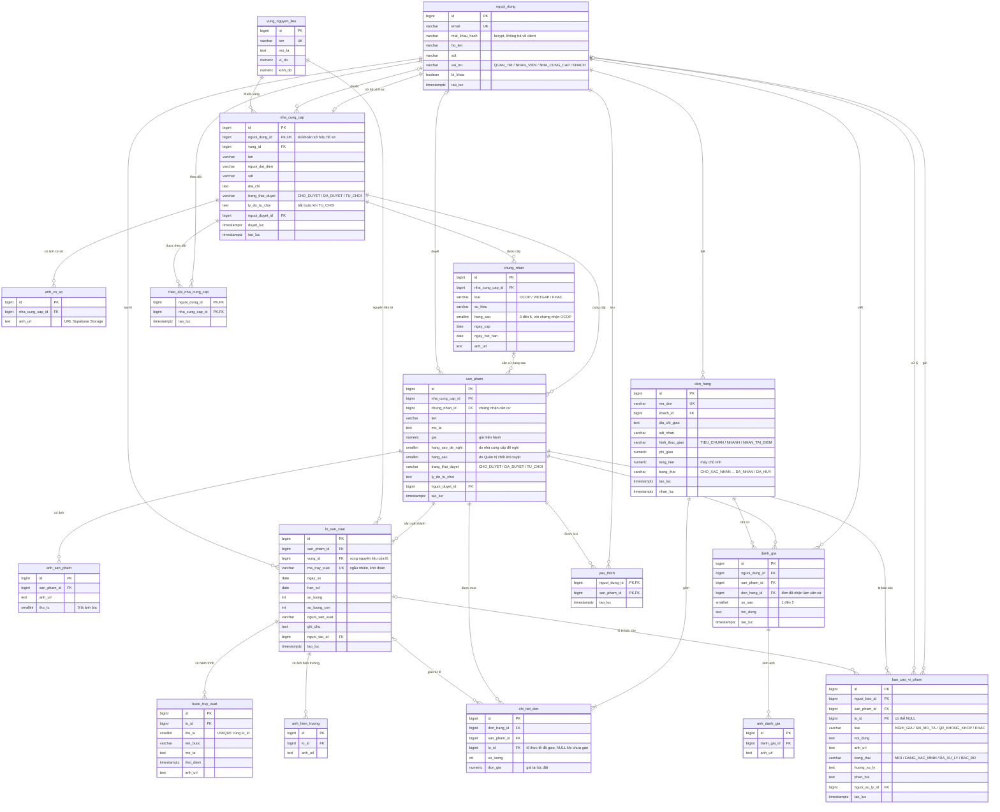

# Mô hình dữ liệu định hướng

Nguồn và cách phân biệt yêu cầu: xem [README](../README.md).

**Bắt buộc:** tối thiểu 8 bảng có khóa ngoại thật và ràng buộc hợp lý, `schema.sql` và `seed.sql` chạy lại được trên CSDL trống. Đề gợi ý các bảng sau; nhóm cần bổ sung bảng để đáp ứng toàn bộ chức năng.

| Nhóm | Bảng gợi ý | Quan hệ và ý nghĩa |
| --- | --- | --- |
| Danh mục | `vung_nguyen_lieu`, `nha_cung_cap`, `chung_nhan`, `san_pham` | Nhà cung cấp thuộc vùng, có chứng nhận và sản phẩm; sản phẩm có hạng sao, trạng thái duyệt. |
| Truy xuất | `lo_san_xuat`, `buoc_truy_xuat` | Một sản phẩm có nhiều lô, một lô có nhiều bước; mã truy xuất duy nhất. Lưu vùng, người sản xuất và ảnh phù hợp yêu cầu của lô. |
| Mua hàng | `nguoi_dung`, `don_hang`, `chi_tiet_don` | Đơn thuộc khách; chi tiết liên kết sản phẩm và lô thực tế đã giao. Cần thiết kế thêm nếu một dòng giao nhiều lô. |
| Tương tác | `danh_gia`, `bao_cao_vi_pham`, `yeu_thich`, `theo_doi_nha_cung_cap` | Lưu đánh giá, ảnh, báo cáo và quan hệ giữa người dùng với sản phẩm hoặc nhà cung cấp. |

Khóa ngoại liên kết các bản ghi hợp lệ; `UNIQUE` ngăn trùng mã lô; `NOT NULL` bảo đảm trường bắt buộc. Không dùng tên bảng trong danh sách này như một thiết kế hoàn chỉnh: nhóm cần vẽ ERD, chốt thuộc tính, quyền và vòng đời dữ liệu trước khi viết schema.

## Các cột chính được đề gợi ý

Đây là thông tin tham khảo từ bảng của đề 5, chưa phải schema cuối cùng. Nhóm cần xác định khóa, kiểu dữ liệu và trường bắt buộc phù hợp khi thiết kế.

| Bảng | Các cột chính được gợi ý |
| --- | --- |
| `vung_nguyen_lieu` | ID, tên, mô tả, vĩ độ, kinh độ. |
| `nha_cung_cap` | ID, tên, người đại diện, số điện thoại, địa chỉ, ID vùng, trạng thái duyệt, ảnh cơ sở. |
| `chung_nhan` | ID, ID nhà cung cấp, loại, số hiệu, ngày cấp, ngày hết hạn, URL ảnh. |
| `san_pham` | ID, ID nhà cung cấp, tên, mô tả, giá, hạng sao, URL ảnh, trạng thái duyệt. |
| `lo_san_xuat` | ID, ID sản phẩm, mã truy xuất, ngày sản xuất, hạn sử dụng, số lượng, ghi chú. |
| `buoc_truy_xuat` | ID, ID lô, thứ tự, tên bước, mô tả, thời điểm, URL ảnh. |
| `don_hang`, `chi_tiet_don` | Đơn có ID, ID khách, tổng tiền, trạng thái, địa chỉ giao; chi tiết ghi ID lô đã giao. |
| `bao_cao_vi_pham` | ID, ID sản phẩm, ID lô, ID người báo, nội dung, URL ảnh, trạng thái. |

Thông tin vùng nguyên liệu, người sản xuất và ảnh hiện trường của lô cũng phải được hệ thống quản lý theo yêu cầu chức năng, dù bảng lô gợi ý trong đề chưa liệt kê hết các trường này.

## Schema đang triển khai

`backend/db/schema.sql` hiện có 16 bảng: `vung_nguyen_lieu`, `nguoi_dung`, `nha_cung_cap`, `chung_nhan`, `san_pham`, `lo_san_xuat`, `buoc_truy_xuat`, `gio_hang`, `don_hang`, `chi_tiet_don`, `lich_su_trang_thai_don`, `danh_gia`, `anh_danh_gia`, `bao_cao_vi_pham`, `yeu_thich`, `theo_doi_nha_cung_cap`. Ngoài các cột đề gợi ý, lô có thêm `so_luong_con`, `vung_nguyen_lieu_id`, `nguoi_san_xuat` và `anh_hien_truong_url`. `chi_tiet_don` và `bao_cao_vi_pham` tham chiếu `(lo_id, san_pham_id)` để bảo đảm lô thuộc đúng sản phẩm. Lý do và các quy tắc đề xuất: [Design decisions](Design_decisions.md).

**Khác biệt giữa schema đang chạy và sơ đồ ERD đề xuất bên dưới (cần nhóm chốt một phương án):**

| Điểm | Schema đang chạy (`backend/db/schema.sql`) | Sơ đồ ERD đề xuất |
| --- | --- | --- |
| Vai trò | `QUAN_TRI`, `NHAN_VIEN`, `KHACH`; nhân viên nhập hồ sơ nhà cung cấp (`nguoi_tao_id`) | Thêm `NHA_CUNG_CAP` có tài khoản riêng (`nha_cung_cap.nguoi_dung_id` `UNIQUE`), tự gửi hồ sơ qua app Client |
| Hạng sao | Chỉ `hang_sao` do Quản trị chốt khi duyệt | Thêm `hang_sao_de_nghi` do nhà cung cấp gửi |
| Mã truy xuất | 20 ký tự hex (80 bit ngẫu nhiên), `CHECK` định dạng | Ví dụ 16 ký tự từ `crypto.randomBytes` |
| Lô của dòng đơn | `chi_tiet_don.lo_id` `NOT NULL`, gán lô lúc đặt (FIFO) | `lo_id` có thể `NULL`, gán khi chuẩn bị giao |
| Giỏ hàng | Có bảng `gio_hang` | Lưu trên máy bằng `shared_preferences` |
| Số bảng | 16 | 17 |

Khi nhóm chọn phương án, cập nhật cùng lúc `schema.sql`, `seed.sql`, code backend, [API](API.md), [Design decisions](Design_decisions.md) và sơ đồ này.

## Sơ đồ ERD (đề xuất của nhóm)

**Đề xuất, chưa phải schema cuối cùng.** Sơ đồ dựa trên bảng gợi ý của đề 5, bổ sung các bảng cần cho chức năng bắt buộc (tài khoản, nhiều ảnh, đánh giá kèm ảnh, yêu thích, theo dõi). Sơ đồ cũng theo phương án nhóm đang đề xuất: nhà cung cấp có tài khoản riêng, đăng nhập app Client để gửi hồ sơ và sản phẩm chờ duyệt. Phương án này cần giảng viên xác nhận, xem [Open questions](Open_questions.md). Sơ đồ use case nằm ở [Use case](Use_case.md).

Cách đọc ký hiệu (crow's foot):

| Ký hiệu | Ý nghĩa |
| --- | --- |
| `PK` / `FK` / `UK` | Khóa chính / khóa ngoại / giá trị duy nhất (`UNIQUE`). |
| `\|\|--o{` | Một – nhiều: một bản ghi bên trái có 0 hoặc nhiều bản ghi bên phải. |
| `\|\|--\|{` | Một – nhiều, bắt buộc có ít nhất 1 (một đơn có ít nhất 1 dòng hàng). |
| `\|\|--o\|` | Một – không hoặc một (một tài khoản sở hữu tối đa một hồ sơ nhà cung cấp). |
| `\|o--o{` | Khóa ngoại có thể để trống (`NULL`), ví dụ dòng hàng chưa được gán lô. |

### Giải thích các điểm chính

- **17 bảng**, đều nối bằng khóa ngoại thật, vượt mức tối thiểu 8 bảng của đề. Ảnh chỉ lưu URL trên Supabase Storage, không lưu base64 trong CSDL.
- **Sản phẩm khác lô.** `san_pham` là mặt hàng chung; `lo_san_xuat` là từng đợt sản xuất, có `ma_truy_xuat` riêng và `buoc_truy_xuat` riêng. `GET /truy-xuat/:maTruyXuat` tìm theo mã của lô, nên quét QR lô A chỉ trả hành trình của lô A.
- **Mã truy xuất khó đoán:** máy chủ sinh ngẫu nhiên (ví dụ 16 ký tự từ `crypto.randomBytes`), có `UNIQUE`; không dùng `id` tăng dần làm mã.
- **Người dùng và vai trò:** một bảng `nguoi_dung` với cột `vai_tro`. `QUAN_TRI` và `NHAN_VIEN` dùng app Admin; `KHACH` và `NHA_CUNG_CAP` dùng app Client (đề xuất). `nha_cung_cap.nguoi_dung_id` có `UNIQUE` nên một tài khoản chỉ sở hữu một hồ sơ. Quyền do backend kiểm tra theo `vai_tro` trong JWT.
- **Duyệt:** `nha_cung_cap` và `san_pham` có `trang_thai_duyet`, `ly_do_tu_choi`, `nguoi_duyet_id`. Đề xuất ràng buộc `CHECK`: khi `TU_CHOI` thì `ly_do_tu_choi` không được trống. Nhà cung cấp chỉ gửi `hang_sao_de_nghi`; `hang_sao` chính thức do Quản trị chốt.
- **Đơn và lô đã giao:** `chi_tiet_don.lo_id` ghi lô thực tế đã giao, có thể `NULL` khi đơn mới đặt. Đề xuất: backend chỉ cho chuyển đơn sang `DANG_GIAO` khi mọi dòng đã có lô. Nếu một dòng phải giao từ nhiều lô, tách thành nhiều dòng cùng `san_pham_id`; quy tắc này cần nhóm chốt.
- **Giá và tồn kho:** `chi_tiet_don.don_gia` lưu giá tại lúc đặt; `don_hang.tong_tien` do máy chủ tính. Tạo đơn, tạo các dòng và trừ `so_luong_con` của lô nằm trong một transaction.
- **Ràng buộc đề xuất khác:** `CHECK` cho `hang_sao` (3–5), `so_sao` (1–5), `so_luong > 0`, `gia >= 0`, `han_sd > ngay_sx`; `UNIQUE (lo_id, thu_tu)` cho bước truy xuất; `UNIQUE (nguoi_dung_id, san_pham_id, don_hang_id)` cho đánh giá. Backend kiểm tra thêm: chỉ được đánh giá khi đơn đã ở `DA_NHAN` và có chứa sản phẩm đó.
- **Giỏ hàng** chưa có bảng: đề xuất lưu trên máy bằng `shared_preferences`, giá và tồn kiểm tra lại khi đặt. Nếu nhóm muốn giỏ đồng bộ nhiều thiết bị thì thêm bảng `gio_hang`.
- Tên các giá trị trạng thái (đơn, báo cáo, chứng nhận) là đề xuất theo [Rule](Rule.md), chưa phải yêu cầu chính thức của đề.
