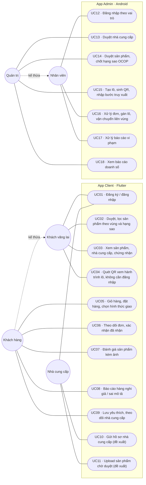

# Sơ đồ use case

Nguồn và cách phân biệt yêu cầu: xem [README](../README.md).

**Bắt buộc:** báo cáo phải có danh sách tác nhân, sơ đồ use case và mô tả 5–7 use case quan trọng nhất; bản nháp nộp ở mốc tuần 9 (xem [Delivery](../course/Delivery.md)).

**Nhóm đã chốt (01/11/2026), nên báo giảng viên:** nhà cung cấp có tài khoản riêng và dùng app Client để gửi hồ sơ, upload sản phẩm chờ duyệt (UC10, UC11). Đề 5 chỉ có API `POST /nha-cung-cap` mà không nói ai gửi, còn slide giới thiệu ghi app Client dành cho khách hàng. Các use case còn lại lấy từ danh sách chức năng bắt buộc của đề. Thiết kế dữ liệu tương ứng nằm ở [Data model](Data_model.md).

## Tác nhân

| Tác nhân | Dùng app | Mô tả |
| --- | --- | --- |
| Khách vãng lai | Client | Người chưa đăng nhập, ví dụ người cầm gói hàng quét QR. Xem sản phẩm và truy xuất lô. |
| Khách hàng | Client | Khách đã đăng nhập (`KHACH`). Làm được mọi việc của khách vãng lai, cộng thêm mua hàng, đánh giá, báo cáo, yêu thích. |
| Nhà cung cấp | Client | Cơ sở sản xuất, HTX (`NHA_CUNG_CAP`, nhóm đã chốt). Gửi hồ sơ và sản phẩm để sàn duyệt. |
| Nhân viên | Admin | `NHAN_VIEN`: xử lý đơn hàng, vận chuyển và báo cáo vi phạm. |
| Quản trị | Admin | `QUAN_TRI`: làm được mọi việc của Nhân viên, cộng thêm duyệt, quản lý lô và xem doanh số. |

Tên và quyền của vai trò là đề xuất theo [Rule](Rule.md). Đề chỉ bắt buộc app Admin có ít nhất hai vai trò thấy chức năng khác nhau, và backend phải chặn truy cập trái vai trò.

## Sơ đồ

Mermaid không có loại sơ đồ use case UML riêng, nên sơ đồ dưới đây dùng flowchart. Tác nhân là hình tròn, use case là hình bầu dục, hai khung là phạm vi hai app. Mũi tên nét đứt "kế thừa" nghĩa là tác nhân con làm được mọi use case của tác nhân cha. Nếu giảng viên yêu cầu ký hiệu UML chuẩn (hình người, đường bao hệ thống, `<<include>>`/`<<extend>>`), nhóm vẽ lại từ sơ đồ này bằng draw.io hoặc StarUML để đưa vào báo cáo.

## Mô tả các use case quan trọng

### UC04 · Quét QR xem hành trình lô (điểm nhấn của đề)

- **Tác nhân:** Khách vãng lai (không cần đăng nhập).
- **Tiền điều kiện:** gói hàng có tem QR chứa `ma_truy_xuat` của lô.
- **Luồng chính:** quét QR hoặc nhập mã → app gọi `GET /truy-xuat/:maTruyXuat` không kèm JWT → hiện sản phẩm, nhà cung cấp, vùng nguyên liệu, ngày sản xuất, hạn dùng và các bước truy xuất theo `thu_tu` của **đúng lô đó**.
- **Ngoại lệ:** mã không tồn tại → báo "Mã không hợp lệ", không lộ thông tin khác. API công khai chỉ trả dữ liệu truy xuất, không trả thông tin cá nhân.

### UC05 · Đặt hàng

- **Tác nhân:** Khách hàng.
- **Tiền điều kiện:** đã đăng nhập, giỏ có sản phẩm đã duyệt.
- **Luồng chính:** chọn địa chỉ và hình thức giao → `POST /don-hang` → backend lấy giá hiện hành từ CSDL, kiểm tra tồn, tính phí và tổng tiền, tạo `don_hang` và các `chi_tiet_don` trong **một transaction** → trả mã đơn ở trạng thái `CHO_XAC_NHAN`.
- **Ngoại lệ:** hết hàng hoặc sản phẩm bị khóa → hủy toàn bộ transaction, báo lỗi và không tạo đơn dở dang. Giá do client gửi lên bị bỏ qua.

### UC10 · Gửi hồ sơ nhà cung cấp (đề xuất)

- **Tác nhân:** Nhà cung cấp.
- **Luồng chính:** đăng ký tài khoản loại "Bán hàng" → điền thông tin cơ sở, giấy chứng nhận, ảnh cơ sở → `POST /nha-cung-cap` → hồ sơ ở `CHO_DUYET`.
- **Ngoại lệ:** form thiếu hoặc sai (ví dụ số điện thoại không đủ 10 số) → chặn gửi ngay trên app; backend kiểm tra lại. Bị từ chối → thấy lý do, sửa và gửi lại.

### UC13 · Duyệt nhà cung cấp

- **Tác nhân:** Quản trị.
- **Luồng chính:** xem hồ sơ, chứng nhận, ảnh cơ sở → `PATCH /nha-cung-cap/:id/duyet` với `DA_DUYET` hoặc `TU_CHOI` kèm lý do.
- **Ngoại lệ:** từ chối mà không có lý do → backend trả lỗi 400. Tài khoản Nhân viên hoặc Nhà cung cấp gọi API này → 403.

### UC15 · Tạo lô, sinh QR, nhập bước truy xuất

- **Tác nhân:** Quản trị.
- **Tiền điều kiện:** sản phẩm đã được duyệt.
- **Luồng chính:** nhập ngày sản xuất, hạn dùng, số lượng, vùng, người sản xuất, ảnh hiện trường → `POST /lo-san-xuat` → máy chủ sinh `ma_truy_xuat` ngẫu nhiên, duy nhất → in tem QR → thêm từng bước bằng `POST /lo-san-xuat/:id/buoc`.
- **Ngoại lệ:** hạn dùng trước ngày sản xuất, hoặc trùng thứ tự bước → báo lỗi tại ô nhập.

### UC16 · Xử lý đơn, gán lô, vận chuyển

- **Tác nhân:** Nhân viên hoặc Quản trị.
- **Luồng chính:** xác nhận đơn → gán lô thực tế cho từng dòng hàng → chuyển `DANG_GIAO`, `DA_GIAO` bằng `PATCH /don-hang/:id/trang-thai`. Khách xác nhận `DA_NHAN` ở UC06.
- **Ngoại lệ:** chuyển trạng thái sai thứ tự, hoặc giao khi còn dòng chưa gán lô → backend từ chối.
